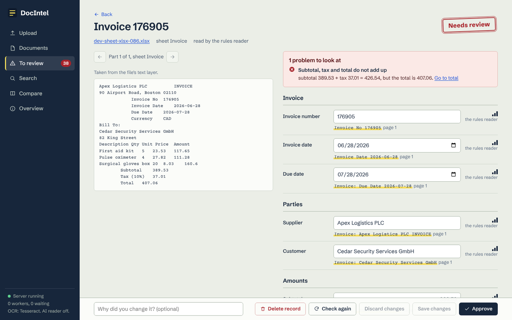
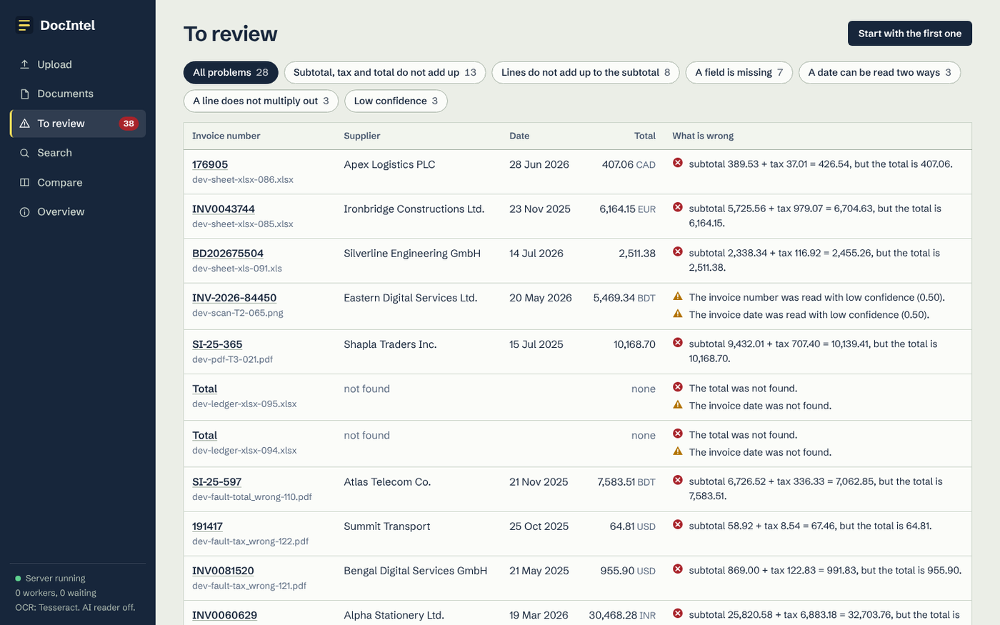

# DocIntel: document intelligence for invoices

Upload invoices, receipts, scans and spreadsheets. DocIntel reads them (text layer, OCR, or cell by cell), pulls out the invoice number, dates, supplier, customer, subtotal, tax, total, currency and line items as structured data, checks that the numbers add up, flags what needs a person, and makes everything searchable through a REST API and a web app.

It is my submission for the home assessment "AI-Powered Document Intelligence System" (Senior AI Engineer, Care Guide BD). Most of the code was written with Claude, an AI assistant, working from the assessment brief; the disclosure is at the bottom of this page and in `AI_Prompts.docx`.



## Contents

[Quick start](#quick-start) · [What it does](#what-it-does) · [Results](#results) · [Using it](#using-it) · [Configuration](#configuration) · [Tests](#tests) · [Evaluation](#evaluation) · [Project layout](#project-layout) · [Honest limits](#honest-limits) · [AI assistance](#ai-assisted-development)

Other documents: [architecture and diagram](docs/ARCHITECTURE.md) · [database schema](docs/DATABASE.md) · [API reference](docs/API.md) · [security](docs/SECURITY.md) · [limitations](docs/LIMITATIONS.md) · [evaluation report](EVALUATION.md) · [demo walkthrough](docs/WALKTHROUGH.md) · [sample files](samples/README.md)

## Quick start

You need 64-bit Python 3.11 or newer (developed and tested with 3.13 on Linux; I did not run it on Windows or macOS, see the Windows paragraph below for what I could check). Tesseract is optional.

```bash
git clone https://github.com/Xerefrux/ai-document-intelligence-system.git
cd ai-document-intelligence-system

python -m venv .venv
source .venv/bin/activate            # Windows PowerShell: .venv\Scripts\Activate.ps1
pip install -e ".[dev]"              # use  pip install -e .  if you only want to run it

docintel doctor                      # checks Python, OCR, the database and the data folder
docintel seed samples                # optional: loads the demo files and processes them
docintel serve                       # then open http://127.0.0.1:8000
```

The web app is already built and is served by the same process, so Python is all you need. Interactive API documentation is at `http://127.0.0.1:8000/api/docs`.

**Windows (PowerShell, or the terminal inside VS Code).** Install 64-bit Python from python.org (tick "Add python.exe to PATH") and Git for Windows, open the project folder, and run:

```powershell
py -m venv .venv
Set-ExecutionPolicy -Scope CurrentUser -ExecutionPolicy RemoteSigned   # once; lets PowerShell run the activate script
.venv\Scripts\Activate.ps1
pip install -e ".[dev]"
python -m docintel doctor
python -m docintel --data-dir demo-data serve                          # then open http://127.0.0.1:8000
```

`python -m docintel` is the same program as the `docintel` command and still works when the launcher is not on the PATH. I could not run Windows where I worked. What I did check: every dependency has a Windows build for Python 3.11 to 3.14 (64-bit), the whole test suite passes with a strict ASCII default text encoding (stricter than the Windows code page), and `tests/test_windows.py` forces the Windows only problems I know of (a wrong registry entry for `.js` files, and an open file that blocks deletion). The first real Windows run is yours. If RapidOCR fails to load with a DLL error, install the Microsoft Visual C++ Redistributable (x64).

**OCR.** For scans and images the system uses Tesseract when it is installed (`sudo apt install tesseract-ocr`, `brew install tesseract`, or the Windows installer from the UB Mannheim page, with `tesseract` on your PATH). Without it, it falls back to RapidOCR, which comes with `pip install` and needs nothing else. On my test scans the two engines scored about the same (see EVALUATION.md); RapidOCR more often drops the spaces between words on blurred text. `docintel doctor` tells you which one you have. Scanned PDFs and photos need one of them; digital PDFs and spreadsheets need neither.

**AI extraction (optional).** Everything works without it, and every number in this repository was measured without it. To switch it on, set `GEMINI_API_KEY` (or `OPENAI_API_KEY` and `OPENAI_MODEL`) before `docintel serve`. See [Honest limits](#honest-limits) for what that does and does not mean.

## What it does

The assessment has seven tasks. Here is where each one lives and what checks it.

| Task | Where | Checked by |
|---|---|---|
| 1. Document processing: PDF, JPG, PNG, TIFF, XLSX, XLS, CSV; text layer, OCR, spreadsheets; multi-page, multi-sheet, poor quality, corrupted | `docintel/pipeline/` | `tests/test_readers.py` (30), `tests/test_windows.py` (5), failure tests in `tests/test_system.py`, `evaluation/e2e.py` |
| 2. Extraction as JSON, never inventing a value | `docintel/extraction/` | `tests/test_extraction.py` (27), `tests/test_normalize.py` (28), `tests/test_llm.py` (18), `evaluation/` |
| 3. Validation: missing fields, bad numbers, duplicates, subtotal, tax, line item and total checks, flag for review | `docintel/validation/` | `tests/test_validation.py` (13), `tests/test_system.py`, `evaluation/e2e.py` |
| 4. REST API: upload, status, results, search, manual correction, reprocess failed jobs, background work | `docintel/api/`, `docintel/jobs/` | `tests/test_system.py` (39) |
| 5. Database and search: metadata, text, structured results, issues, history; keyword and semantic | `docintel/db/`, `docintel/search/` | `tests/test_system.py` |
| 6. Front end: upload many, watch progress, inspect, review issues, correct, search | `frontend/` (React), built into `docintel/static` | type checked, 18 small tests (`npm test`), `scripts/ui_smoke.py` (opens every screen in a real browser), and checked by hand at desktop and phone width |
| 7. Testing and evaluation on a labelled set | `tests/`, `evaluation/` | `pytest`, then [EVALUATION.md](EVALUATION.md) |

A few things worth knowing about how it behaves:

- A value that is not on the page stays empty. The extractor never guesses, and every value it does return carries the line it was read from and a confidence.
- A file that cannot be read fails alone, with a code and a plain message, and never blocks or loses the rest of its batch.
- A job survives a crash: pages are saved as they are read, a worker that stops mid-job is detected by its missing heartbeat, and the job goes back in the queue and resumes after the last stored page.
- Anything with an error or a warning goes to a review queue. A person sees the source page beside the values, corrects what is wrong, and every correction is re-validated and written to an audit trail.
- Cross verification compares invoices with a spreadsheet register (the "pdf to excel" check in the brief) and reports matches, mismatches field by field, and rows that have no partner.



## Results

All of this is measured on synthetic documents that I generated, with the rules extractor only (the AI path is not measured). [EVALUATION.md](EVALUATION.md) has the method, the definitions, every table and the weak points; the short version:

| | Files | Field accuracy | Whole document right |
|---|---|---|---|
| Digital PDFs, development set (what I tuned on) | 60 | 100% | 100% |
| Digital PDFs, holdout set after fixes | 40 | 100% | 100% |
| Digital PDFs, **holdout set, first blind run** | 40 | **96.7%** | **50.0%** |
| Spreadsheets (xlsx, xls, csv), development / holdout after fixes | 18 / 18 | 100% / 100% | 100% / 100% |
| Spreadsheets, **holdout, first blind run** | 18 | **90.6%** | **52.2%** |
| Scans with Tesseract, development / holdout | 24 / 16 | 63.5% / 56.0% | 33.3% / 6.2% |

- **Scans depend on damage.** Light scans: 95% to 98% of fields right. Medium: 66% to 88%. Heavy: mostly unreadable (0% to 28%), and with Tesseract every heavy scan was sent to manual review rather than guessed. Two scans in sixteen (holdout) had a wrong invoice number that nothing flagged (OCR read `SI` as `S1` or `$1`).
- **Reliability.** 190 of 190 valid development files and 162 of 162 holdout files were processed without a failure. The 14 deliberately broken files per set (truncated, password protected, random bytes, empty, and so on) all ended where they should.
- **Validation.** All 61 injected mistakes that a layout could show (wrong total, subtotal, tax or line amount, missing number or date, due date before invoice date, ambiguous date) were flagged, and all 104 duplicate cases (identical file, same invoice in another layout, same supplier, date and total under a new number, and look alikes that must not be flagged) came out right.
- **Speed.** A digital invoice takes about 0.01 s. One text PDF of **1000 pages with 434 invoices** went from upload to searchable in **15 s**, with all 434 invoice numbers and totals right. A scan takes 1 to 20 s depending on quality. A scanned 1000 page file was not run; my estimate is about an hour on two cores.
- **Not representative.** The documents are synthetic and made by the same session that wrote the extractor, so expect lower numbers on real ones. The "first blind run" rows are the better guide to unseen layouts.

## Using it

### In the web app

Upload (drag in many files at once, or a folder), watch each file move through its stages, open a record to see the page image next to the values with the evidence for each one, fix a value and approve it, work through the review queue, search, and compare invoices against a register. [docs/WALKTHROUGH.md](docs/WALKTHROUGH.md) is a click-by-click demo using the files in `samples/`.

### From the command line

```bash
docintel process samples/invoices/*.pdf        # print extracted JSON, no database
docintel seed samples                          # load a folder into the database and process it
docintel serve --port 8000 --workers 2         # API, web app and two background workers
docintel worker --count 4                      # extra workers as separate processes (set DOCINTEL_WORKERS=0 on the API)
docintel reindex                               # rebuild the search vectors
docintel doctor
```

### Over HTTP

```bash
# upload one or many files; each gets its own status in the answer
curl -F "files=@samples/invoices/layout-1-INV-2025-07745.pdf" http://127.0.0.1:8000/api/documents

curl http://127.0.0.1:8000/api/documents                  # list, with processing status and progress
curl http://127.0.0.1:8000/api/documents/<document id>    # one document: records, issues, history
curl http://127.0.0.1:8000/api/records/<record id>        # every field with its evidence and confidence

curl "http://127.0.0.1:8000/api/search?q=thermometer&mode=hybrid&min_total=100"   # keyword, semantic or hybrid, with filters

curl -X PATCH http://127.0.0.1:8000/api/records/<record id> \
     -H "Content-Type: application/json" \
     -d '{"fields": {"total": "1234.50"}, "note": "typo on the scan", "expected_version": 1}'

curl -X POST http://127.0.0.1:8000/api/documents/reprocess-failed      # queue failed documents again
curl "http://127.0.0.1:8000/api/export/records?format=csv" -o records.csv
```

If `DOCINTEL_API_KEY` is set, add `-H "X-API-Key: <key>"`. The complete list of 27 endpoints is in [docs/API.md](docs/API.md).

## Configuration

Everything is an environment variable with the prefix `DOCINTEL_` (or a `.env` file). The ones you are likely to want:

| Variable | Default | What it does |
|---|---|---|
| `DOCINTEL_DATA_DIR` | `./data` | database, uploaded files and logs |
| `DOCINTEL_HOST`, `DOCINTEL_PORT` | `127.0.0.1`, `8000` | where the server listens |
| `DOCINTEL_API_KEY` | empty | when set, every `/api` call needs it (`X-API-Key` or Bearer) |
| `DOCINTEL_WORKERS` | `1` | background workers inside the API process; `0` to run `docintel worker` separately |
| `DOCINTEL_OCR_ENGINE` | `auto` | `auto`, `tesseract` or `rapidocr` |
| `DOCINTEL_OCR_PROCESSES` | `0` | size of the OCR process pool; `0` picks up to 4 from the CPU count |
| `DOCINTEL_EXTRACTION_MODE` | `auto` | `rules`: never call an AI. `auto`: rules first, and with an AI key set the model is asked only about records the rules are unsure about. `hybrid`: the model reads every record too. `llm`: the model's reading is preferred, the rules are the fallback |
| `GEMINI_API_KEY`, `OPENAI_API_KEY` + `OPENAI_MODEL` | empty | enable the AI path |
| `DOCINTEL_EMBEDDING_PROVIDER` | `hash` | semantic search vectors: `hash` (offline, fuzzy keyword match), `gemini`, `openai`, or `none` |
| `DOCINTEL_AMOUNT_TOLERANCE` | `0.05` | how far amounts may differ before they count as not adding up |
| `DOCINTEL_REVIEW_CONFIDENCE` | `0.60` | a required field read with less confidence than this is flagged |
| `DOCINTEL_DATE_ORDER` | `auto` | `dmy` or `mdy` to force one reading of 03/04/2026 |
| `DOCINTEL_MAX_UPLOAD_MB` | `100` | per file |
| `DOCINTEL_RATE_LIMIT_PER_MINUTE` | `600` | per client, `0` turns it off |
| `DOCINTEL_OCR_RETRY_BUDGET_SECONDS` | `15` | how long to keep trying rotations and clean-ups on one hopeless page |
| `DOCINTEL_DATABASE_URL` | SQLite file in the data folder | only SQLite was tested |

The full list, with ranges, is in `docintel/config.py`; `GET /api/config` shows the values in use without any keys.

## Tests

```bash
pytest                      # 160 tests, about half a minute (it depends on the machine)
pytest tests/test_system.py # API, queue and workers, search, security, failure scenarios
```

The output of the last full run is saved in `evaluation/results/pytest_results.txt` (Python) and `frontend_test_results.txt` (front end).

Sample files are generated while the tests run, so the repository carries no binary test data. The suite covers file type detection and OCR, spreadsheet parsing, extraction on every layout, normalisation, validation rules, the AI client against a mock server (retries, rate limits, a service that is down, answers that are invented or malformed), the whole API end to end, retry and crash recovery of the queue, search, authentication, rate limiting, size limits, hostile file names and broken files. The front end has 18 small tests (formatting helpers, a few components, the search page and the message that replaces a screen that fails to draw; `cd frontend && npm test`). Most pages have no test of their own, so `scripts/ui_smoke.py` opens every screen of a running server in a real browser and fails on a blank window or any script error. It needs Playwright, so it is not part of `pytest`:

```bash
pip install playwright && playwright install chromium
docintel --data-dir ./demo-data seed samples
docintel --data-dir ./demo-data serve        # in another terminal
python scripts/ui_smoke.py http://127.0.0.1:8000
```

The last run of it is saved in `evaluation/results/ui_smoke_results.txt`.

## Evaluation

[EVALUATION.md](EVALUATION.md) has the method, the definitions, the measured numbers, and what is wrong with them. To reproduce:

```bash
python -m evaluation.build --split dev --out evaluation/dataset
python -m evaluation.build --split holdout --out evaluation/dataset
python -m evaluation.extract_run --split holdout --jobs 2
python -m evaluation.report --split holdout --errors 40
python -m evaluation.e2e --split holdout          # validation, duplicates and broken files through the real API
python -m evaluation.build --perf --out evaluation/dataset   # the 1000 page PDF
```

## Project layout

```
docintel/
  pipeline/      file type detection, PDF text layer, OCR, images, spreadsheets, layout text
  extraction/    labels and rules, line items, spreadsheet layouts, AI client, grounding, merge
  validation/    record rules, duplicate detection, cross verification
  jobs/          queue, worker, the document runner
  search/        FTS5 keyword search, vectors, hybrid ranking
  api/           FastAPI app, routes, security, uploads
  db/            SQLAlchemy models, SQLite engine and FTS5 setup
  static/        the built web app
frontend/        React + TypeScript source (npm run build writes into docintel/static)
evaluation/      synthetic dataset generator, extraction runs, metrics, report, end to end check
tests/           pytest suite
docs/            architecture, database, API, security, limitations, walkthrough
samples/         demo files
scripts/         generators for docs, samples and AI_Prompts.docx
```

## Honest limits

The short version; [docs/LIMITATIONS.md](docs/LIMITATIONS.md) has the long one.

- The test documents are synthetic and were generated by code written in the same session as the extractor. Real documents will score lower.
- I could not reach Gemini or OpenAI where this was built. The AI path is tested against a mock server and its accuracy is **not measured**. All numbers here are from the offline rules extractor.
- The default "semantic" search is a character n-gram hash: it finds typos and word endings, not meanings. Real embeddings need a key and are also untested against the live services.
- Poor scans fail, and the system flags them instead of guessing. A scanned 1000 page file was not measured end to end.
- SQLite only, one machine, no Docker image, no user accounts, no TLS of its own. Tested on Linux only.

## AI assisted development

I used Claude (Anthropic) as a coding assistant for this project, and it wrote most of the code, the tests, the data generator and these documents from the assessment brief and my instructions. I set the rules (measure everything you report, label what is synthetic, claim nothing that was not run), made the scope decisions, and I am submitting it. `AI_Prompts.docx` has the full disclosure, the exact prompts the product sends to a model, and the instructions I gave while building.
