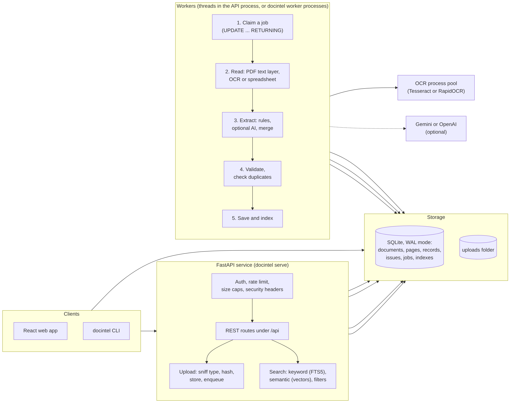
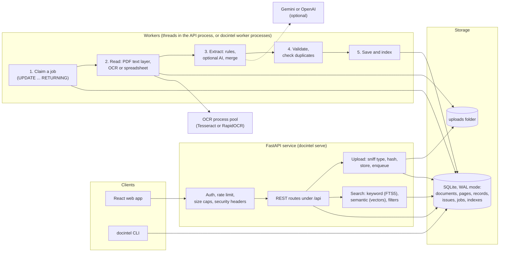

# Architecture

DocIntel is one Python service with background workers. The service exposes a REST API, serves the React app, and keeps all state in one database and one uploads folder. There is no message broker and no separate search server: the queue, the full text index and the vectors all live in the database. That is a deliberate choice, explained below, and it is also the main thing to change if the load ever outgrows one machine.

The diagram source is in `docs/diagrams/architecture.mmd`. Here it is in text form, so it renders on GitHub too:

## What happens to a file

1. **Upload.** `POST /api/documents` streams each file to disk (never into memory), checks its first bytes to see what it really is (a PNG named `invoice.pdf` is processed as a PNG, an executable named `invoice.pdf` is rejected), computes a SHA-256, and recognises an exact repeat of a file that is already stored. New files get a `documents` row and a `jobs` row, and the request returns at once with one status per file. Each file succeeds or is rejected on its own, so one bad file in a batch of fifty does not stop the other forty-nine.
2. **Claim.** A worker takes the oldest queued job with one `UPDATE ... RETURNING` statement. Two workers can never get the same job.
3. **Read.** The reader opens the file and produces one page of text at a time.
   - PDF: every page is checked on its own. A page with a usable text layer is read directly (fast and exact). A page with no text layer, or with a layer full of garbage, goes to OCR. A scanned PDF, a digital one and a mixed one use the same code.
   - Image (JPG, PNG, TIFF): OCR. A multi-page TIFF is several pages.
   - XLSX, XLS, CSV: read cell by cell. Every sheet becomes a grid for the spreadsheet extractor, and is also rendered as text (300 rows per page) so it can be searched.
4. **OCR.** Tesseract is used when it is installed, otherwise RapidOCR (a pip package with bundled models). Skew is corrected first. If a pass looks poor (low confidence or hardly any text) the page is retried with rotations, a contrast-enhanced copy, a binarized copy and sparse-text mode, and the best pass wins. The retries stop after `DOCINTEL_OCR_RETRY_BUDGET_SECONDS` (15 s by default), so one hopeless page cannot hold a worker for minutes; it is flagged for review instead. OCR runs in a pool of separate processes, because it is CPU bound and Python threads would not help.
5. **Layout text.** Text runs from the PDF or from OCR are placed back into lines and columns (like `pdftotext -layout`), so a table stays a table and a label stays above its value.
6. **Extract.** A long PDF is first cut into invoices (a page with a labelled invoice number different from the previous one starts a new invoice). Each invoice is read by the rules extractor, which finds labels such as "Invoice No", "Bill To" or "Subtotal" and reads the value beside or below them. Every value keeps the line it came from (evidence) and a confidence. If nothing convincing is found the field stays empty. When an AI model is configured, it reads the same text, and the two results are merged (see "Extraction" below).
7. **Validate.** The rules in `validation/rules.py` run on each record, then the duplicate check runs against the database.
8. **Save.** Pages are committed in batches while reading, so a crash or restart resumes after the last stored page. The records, line items and issues of a document are replaced in a single transaction, so a reader of the API never sees half a document.
9. **Index.** The page text and the record text go into the FTS5 indexes, and vectors for semantic search are stored.
10. **Review.** Anything with an error or warning is marked `needs_review`. In the web app a person sees the source page next to the extracted values, corrects what is wrong, and approves. Every edit is validated again and written to an audit trail.

## The job queue

The queue is the `jobs` table. This is what it gives you:

| Behaviour | How |
|---|---|
| No double processing | claim with `UPDATE ... RETURNING` in one statement |
| Retry with backoff | a retryable failure (an OCR crash, a lost worker, a timeout) waits `job_backoff_seconds * 2^(attempt-1)` and tries again, up to `job_max_attempts` |
| No pointless retries | a corrupt, password protected or unsupported file fails immediately and says why |
| Crash recovery | a running job sends a heartbeat; a job whose heartbeat is older than `job_stale_seconds` goes back in the queue, and the document history records that the worker stopped |
| Resume | a retried job continues after the last stored page instead of starting over |
| Cancel | a queued job is cancelled at once; a running one stops at the next page |
| Graceful shutdown | on stop, a running job is put back in the queue rather than failed |
| Scale out | the API runs workers as threads (`DOCINTEL_WORKERS=N`), or run `docintel worker --count N` as separate processes on the same database and set `DOCINTEL_WORKERS=0` on the API |

I chose a database queue over Redis with BullMQ because it removes a service to install and operate, and the throughput limit here is OCR, not queue operations. The cost is that SQLite allows one writer at a time. The queue code is written so that PostgreSQL would use `FOR UPDATE SKIP LOCKED`, but I did not run it on PostgreSQL, so I do not claim it works there.

## Extraction

There are two extractors that can run together.

- **Rules (default, offline).** Needs no network and no key. It reads labels, tables and spreadsheet layouts (ledger with one invoice per row, grouped rows, and a single invoice laid out like a printed one). All the measured numbers in the evaluation report come from this extractor.
- **LLM (optional).** With `GEMINI_API_KEY` or `OPENAI_API_KEY` set, the text goes to the model with a strict JSON schema. The model must quote, for every value, the text it came from. A value is only kept if that quote really occurs in the document and the value can be read from it; anything else is dropped and reported. A model that invents a total cannot put it into the database. Emails, phone numbers, IBANs, bank account numbers and card numbers (digit runs that pass the card checksum, so invoice numbers and amounts stay intact) are masked before the text leaves the machine. This is best effort, not a guarantee. Calls retry with backoff, honour `Retry-After`, and a circuit breaker stops calling a service that keeps failing, so the pipeline falls back to the rules result instead of stalling.
- **Hybrid merge.** When both ran, agreement raises confidence. For money fields, the reading that makes subtotal + tax = total wins. Other disagreements keep the more confident value, cap its confidence below the review threshold, and record both readings.

I could not reach Gemini or OpenAI from the environment where this was built, so the LLM path is tested only against a mock server. Its accuracy is not measured, and I do not report any number for it.

## Validation

Pure functions in `docintel/validation/rules.py`; the same rules run after extraction, after a manual edit and on `revalidate`.

| Code | Severity | Meaning |
|---|---|---|
| MISSING_FIELD | error for a missing invoice number, invoice date, supplier or total (in a spreadsheet ledger row only the number and total are required, and a missing date is a warning); info for customer, currency, subtotal and tax | a value was not found |
| INVALID_NUMBER, INVALID_DATE | error when text was found but cannot be read; warning for zero or negative totals and dates far outside a believable range | |
| DATE_AMBIGUOUS | warning | 03/04/2026 could be two dates and nothing else on the page settles it |
| DUE_BEFORE_INVOICE_DATE | warning | due date earlier than the invoice date |
| LINE_ITEM_MISMATCH | error | quantity times unit price differs from the line amount |
| SUBTOTAL_MISMATCH | error | line amounts do not add up to the subtotal |
| TOTAL_MISMATCH | error | subtotal plus tax, less discount, plus shipping, differs from the total |
| DUPLICATE_INVOICE | error | same supplier and invoice number as an earlier record |
| POSSIBLE_DUPLICATE | warning | same supplier, date and total, different number |
| LOW_CONFIDENCE, UNGROUNDED_VALUE, EXTRACTOR_DISAGREEMENT, OCR_LOW_QUALITY | warning | the reading is shaky and a person should look |
| CROSS_DOC_MISMATCH | warning | disagrees with the matching record in another document |
| NO_INVOICE_DETECTED | warning | the file was read but no invoice was found in it |

Errors and warnings put a record in the review queue; info never does.

Amounts are compared with an absolute tolerance (`DOCINTEL_AMOUNT_TOLERANCE`, 0.05 by default) so rounding does not raise false alarms. The same invoice number from two different suppliers is normal and is not flagged.

Cross verification (`POST /api/reconciliations`) pairs records of two document sets (for example invoice PDFs against an Excel ledger) by normalised invoice number and reports MATCH, MISMATCH with the differing fields, MISSING_LEFT and MISSING_RIGHT.

## Search

- **Keyword.** SQLite FTS5 with bm25 ranking, over page text and over a per-record text (number, parties, line item descriptions). The query tries an exact phrase first, then all words, then any word. The "any word" step is skipped when a term contains digits, so searching for an invoice number does not return every invoice that shares one digit with it. Snippets mark the matched words.
- **Semantic.** Vectors are stored in the `embeddings` table. By default they come from a character n-gram hashing embedder that runs offline. I want to be plain about what that is: it matches typos and word endings ("thermomter" finds "thermometer", "glove" finds "gloves"). It does not know that two different words mean the same thing. With a Gemini or OpenAI key, real semantic embeddings can be used; that code is tested against a mock server only.
- **Hybrid.** The keyword and vector rankings are fused with reciprocal rank fusion, so a result that is high in both lists beats one that is first in only one.
- **Filters** (supplier, dates, amounts, currency, review status, file type, document) apply to every mode, and also work without a search text.

## Web app

React 19 and TypeScript, built with Vite into `docintel/static`, and served by the same FastAPI process, so running the app needs Python only (Node is needed only to change the front end). Screens: upload (many files, per file progress), documents, document detail with processing history, record review (source page beside the values, evidence per field, edit, approve), the review queue, search, cross verification, and an overview with success rate and timings. See the screenshots in the README.

## Reliability

- A failed file never blocks the queue and never loses the others in its batch. It ends as `failed` with a code and a message, and can be reprocessed.
- Crash and restart recovery as described under the queue. Stored pages are kept, results replace atomically.
- Hard limits on file size, pixel count, PDF pages, TIFF frames, sheet rows and columns, and uncompressed size inside an XLSX zip (a decompression bomb guard), so a hostile or broken file fails cleanly instead of using all the memory.
- Time limits: a whole document (`document_timeout_seconds`), an OCR page (`ocr_page_timeout_seconds`), an AI call (`llm_timeout_seconds`).
- `GET /api/health` reports a stalled queue (queued work and no live worker) as `degraded`.
- Every response error has the same shape and carries no paths, stack traces or SQL. Details go to the log with a request id.
- PDFium, the library that reads PDF text and renders pages, is not safe to use from two threads at once and can crash the whole process. Workers and page previews are threads, so every call into it goes through one lock (`pipeline/pdfium_lock.py`), and pages and documents are closed inside it. This bug was found on the last night, when a verbose test run with three worker threads crashed; `test_many_threads_can_read_and_render_pdfs_at_once` now reproduces it (it crashed on three runs out of three before the lock) and the full suite has passed repeatedly since. Rendering a page for OCR takes the same lock wherever it runs.

## Scalability, and where it stops

| What | Today | What I would change first |
|---|---|---|
| OCR throughput | CPU bound; scales with workers and `ocr_processes` on one machine | run `docintel worker` on several machines, which needs a shared database (PostgreSQL) and shared file storage |
| Database writes | SQLite, one writer at a time, WAL | PostgreSQL |
| Vector search | all vectors are read and compared in memory per query | pgvector or an ANN index; fine for tens of thousands of records, not for millions |
| Rate limiter | in memory, per process | Redis based, if several API processes run |
| Large PDFs | read page by page, committed in batches, progress per page | nothing, this part is fine |
| Large spreadsheets | row and column caps, text rendered in pages of 300 rows | streaming reads for sheets beyond the caps |

Measured processing times are in `EVALUATION.md`.

## How this compares with the technology the brief suggested

The brief lists suggestions and allows alternatives if the decisions are explained.

| Brief suggests | Used here | Why |
|---|---|---|
| React or Next.js | React 19 with Vite | A single page app is enough; a Next.js server would add a second process for no gain |
| Node.js or NestJS | Python 3.11+ with FastAPI | OCR, PDF, image and spreadsheet libraries are strongest in Python, and extraction and evaluation share the same code |
| PostgreSQL or MongoDB | SQLite with FTS5 | Zero setup for a reviewer. The cost is one writer and one machine. Schema and queue are written to move to PostgreSQL, but that move is untested |
| Redis or BullMQ | a `jobs` table | One less service. OCR dominates the time, not the queue |
| A vector database | vectors in a table, hashing embedder by default, Gemini or OpenAI embeddings optional | Works offline. Honest limit: the default is fuzzy keyword matching, not meaning |
| An LLM API | optional Gemini or OpenAI client behind a grounding check, with an offline rules extractor as the default | The system works without a key or a network, and a model can never write an unsupported value into the database |
