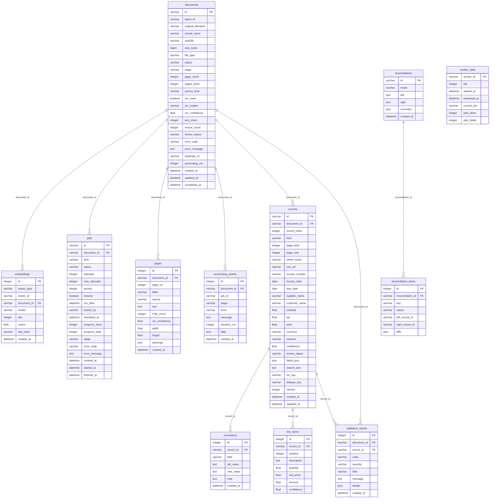

# Database schema

Generated by `scripts/gen_docs.py` from the SQLAlchemy models in `docintel/db/models.py`. Do not edit by hand.

SQLite is the database that is tested. It runs in WAL mode (readers do not block the writer) with foreign keys on. Keyword search uses two FTS5 virtual tables, `page_fts` (over `pages.text`) and `record_fts` (over `records.search_text`). They are external content tables: they hold the index only, the text stays in the original table, and triggers keep them in sync. The models use portable types, so another SQL database can be pointed at with `DOCINTEL_DATABASE_URL`, but only SQLite was run (see docs/LIMITATIONS.md).

## Relationships

`embeddings.owner_id` points at a record or a page (see `owner_type`), so it has no foreign key of its own; its `document_id` column cascades with the document.

## Tables

### documents

| Column | Type | Null | Notes |
|---|---|---|---|
| id | VARCHAR(32) | no | primary key |
| batch_id | VARCHAR(32) | yes |  |
| original_filename | VARCHAR(500) | no |  |
| stored_name | VARCHAR(255) | no |  |
| sha256 | VARCHAR(64) | no | hash of the file bytes; identical uploads are recognised by it |
| size_bytes | BIGINT | no |  |
| file_type | VARCHAR(16) | no |  |
| status | VARCHAR(16) | no | queued, processing, completed, failed, cancelled |
| stage | VARCHAR(40) | yes |  |
| page_count | INTEGER | yes |  |
| pages_done | INTEGER | no |  |
| source_kind | VARCHAR(24) | yes |  |
| ocr_used | BOOLEAN | no |  |
| ocr_engine | VARCHAR(24) | yes |  |
| ocr_confidence | FLOAT | yes |  |
| text_chars | INTEGER | no |  |
| record_count | INTEGER | no |  |
| review_status | VARCHAR(16) | no | none, needs_review, ok, corrected, approved (worst state of its records) |
| error_code | VARCHAR(40) | yes |  |
| error_message | TEXT | yes |  |
| duplicate_of | VARCHAR(32) | yes | id of the earlier document with the same content or the same invoice |
| processing_ms | INTEGER | yes |  |
| created_at | DATETIME | no |  |
| updated_at | DATETIME | no |  |
| completed_at | DATETIME | yes |  |

Indexes: `ix_documents_batch_id` (batch_id), `ix_documents_created_at` (created_at), `ix_documents_review_status` (review_status), `ix_documents_sha256` (sha256), `ix_documents_status` (status)

### reconciliations

| Column | Type | Null | Notes |
|---|---|---|---|
| id | VARCHAR(32) | no | primary key |
| mode | VARCHAR(12) | no |  |
| left | JSON | yes |  |
| right | JSON | yes |  |
| summary | JSON | yes |  |
| created_at | DATETIME | no |  |

### worker_state

| Column | Type | Null | Notes |
|---|---|---|---|
| worker_id | VARCHAR(64) | no | primary key |
| pid | INTEGER | no |  |
| started_at | DATETIME | no |  |
| heartbeat_at | DATETIME | no |  |
| current_job | VARCHAR(32) | yes |  |
| jobs_done | INTEGER | no |  |
| jobs_failed | INTEGER | no |  |

### embeddings

| Column | Type | Null | Notes |
|---|---|---|---|
| id | INTEGER | no | primary key |
| owner_type | VARCHAR(12) | no |  |
| owner_id | VARCHAR(40) | no |  |
| document_id | VARCHAR(32) | no | references documents.id |
| model | VARCHAR(100) | no |  |
| dim | INTEGER | no |  |
| vector | BLOB | no | float32 array stored as bytes |
| text_hash | VARCHAR(40) | no |  |
| created_at | DATETIME | no |  |

Indexes: `ix_embeddings_document_id` (document_id), `ix_embeddings_owner` (owner_type, owner_id)

### jobs

| Column | Type | Null | Notes |
|---|---|---|---|
| id | VARCHAR(32) | no | primary key |
| document_id | VARCHAR(32) | no | references documents.id |
| kind | VARCHAR(16) | no |  |
| status | VARCHAR(12) | no | queued, running, succeeded, failed, cancelled |
| attempts | INTEGER | no |  |
| max_attempts | INTEGER | no |  |
| priority | INTEGER | no |  |
| resume | BOOLEAN | no |  |
| run_after | DATETIME | no | a retried job waits until this time (exponential backoff) |
| locked_by | VARCHAR(64) | yes |  |
| heartbeat_at | DATETIME | yes | a running job with an old heartbeat is put back in the queue |
| progress_done | INTEGER | no |  |
| progress_total | INTEGER | no |  |
| stage | VARCHAR(40) | yes |  |
| error_code | VARCHAR(40) | yes |  |
| error_message | TEXT | yes |  |
| created_at | DATETIME | no |  |
| started_at | DATETIME | yes |  |
| finished_at | DATETIME | yes |  |

Indexes: `ix_jobs_claim` (status, run_after, priority), `ix_jobs_document_id` (document_id)

### pages

| Column | Type | Null | Notes |
|---|---|---|---|
| id | INTEGER | no | primary key |
| document_id | VARCHAR(32) | no | references documents.id |
| page_no | INTEGER | no |  |
| label | VARCHAR(200) | yes |  |
| source | VARCHAR(16) | no | text_layer, ocr, sheet or failed |
| text | TEXT | no |  |
| char_count | INTEGER | no |  |
| ocr_confidence | FLOAT | yes |  |
| width | FLOAT | yes |  |
| height | FLOAT | yes |  |
| warnings | JSON | yes |  |
| created_at | DATETIME | no |  |

Indexes: `ix_pages_document_id` (document_id)

### processing_events

| Column | Type | Null | Notes |
|---|---|---|---|
| id | INTEGER | no | primary key |
| document_id | VARCHAR(32) | no | references documents.id |
| job_id | VARCHAR(32) | yes |  |
| stage | VARCHAR(40) | no |  |
| level | VARCHAR(8) | no |  |
| message | TEXT | no |  |
| duration_ms | INTEGER | yes |  |
| data | JSON | yes |  |
| created_at | DATETIME | no |  |

Indexes: `ix_processing_events_document_id` (document_id)

### reconciliation_items

| Column | Type | Null | Notes |
|---|---|---|---|
| id | INTEGER | no | primary key |
| reconciliation_id | VARCHAR(32) | no | references reconciliations.id |
| key | VARCHAR(160) | yes |  |
| status | VARCHAR(16) | no |  |
| left_record_id | VARCHAR(32) | yes |  |
| right_record_id | VARCHAR(32) | yes |  |
| diffs | JSON | yes |  |

Indexes: `ix_reconciliation_items_reconciliation_id` (reconciliation_id)

### records

| Column | Type | Null | Notes |
|---|---|---|---|
| id | VARCHAR(32) | no | primary key |
| document_id | VARCHAR(32) | no | references documents.id |
| record_index | INTEGER | no |  |
| kind | VARCHAR(16) | no |  |
| page_start | INTEGER | yes |  |
| page_end | INTEGER | yes |  |
| sheet_name | VARCHAR(200) | yes |  |
| row_ref | VARCHAR(60) | yes |  |
| invoice_number | VARCHAR(128) | yes |  |
| invoice_date | DATE | yes |  |
| due_date | DATE | yes |  |
| supplier_name | VARCHAR(300) | yes |  |
| customer_name | VARCHAR(300) | yes |  |
| subtotal | FLOAT | yes |  |
| tax | FLOAT | yes |  |
| total | FLOAT | yes |  |
| currency | VARCHAR(8) | yes |  |
| method | VARCHAR(12) | no | rules, llm or hybrid |
| confidence | FLOAT | yes |  |
| review_status | VARCHAR(16) | no |  |
| fields_json | JSON | yes | every field with confidence, evidence text, page, source and notes |
| search_text | TEXT | no | text indexed by the record_fts full text table |
| inv_key | VARCHAR(160) | yes | normalised invoice number, used for duplicate checks and cross verification |
| dedupe_key | VARCHAR(480) | yes | supplier + date + total, used to find possible duplicates |
| version | INTEGER | no | bumped on every edit; the API refuses an edit made on an old version |
| created_at | DATETIME | no |  |
| updated_at | DATETIME | no |  |

Indexes: `ix_records_dedupe_key` (dedupe_key), `ix_records_doc_idx` (document_id, record_index), `ix_records_inv_key` (inv_key), `ix_records_invoice_date` (invoice_date), `ix_records_invoice_number` (invoice_number), `ix_records_review` (review_status), `ix_records_supplier` (supplier_name), `ix_records_total` (total)

### corrections

| Column | Type | Null | Notes |
|---|---|---|---|
| id | INTEGER | no | primary key |
| record_id | VARCHAR(32) | no | references records.id |
| field | VARCHAR(40) | no |  |
| old_value | TEXT | yes |  |
| new_value | TEXT | yes |  |
| note | TEXT | yes |  |
| created_at | DATETIME | no |  |

Indexes: `ix_corrections_record_id` (record_id)

### line_items

| Column | Type | Null | Notes |
|---|---|---|---|
| id | INTEGER | no | primary key |
| record_id | VARCHAR(32) | no | references records.id |
| position | INTEGER | no |  |
| description | TEXT | yes |  |
| quantity | FLOAT | yes |  |
| unit_price | FLOAT | yes |  |
| amount | FLOAT | yes |  |
| confidence | FLOAT | yes |  |

Indexes: `ix_line_items_record_id` (record_id)

### validation_issues

| Column | Type | Null | Notes |
|---|---|---|---|
| id | INTEGER | no | primary key |
| document_id | VARCHAR(32) | no | references documents.id |
| record_id | VARCHAR(32) | yes | references records.id; null for problems with the whole document |
| code | VARCHAR(40) | no |  |
| severity | VARCHAR(8) | no |  |
| field | VARCHAR(40) | yes |  |
| message | TEXT | no |  |
| details | JSON | yes |  |
| created_at | DATETIME | no |  |

Indexes: `ix_issues_code` (code), `ix_issues_doc` (document_id), `ix_validation_issues_record_id` (record_id)

